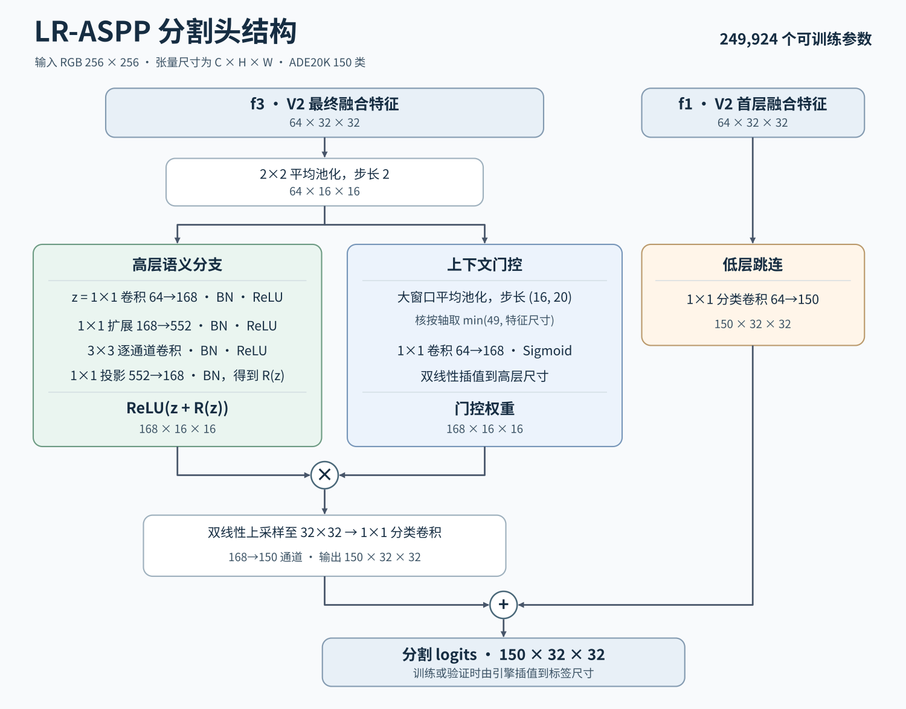

# V2 SeaFormer + LR-ASPP

本目录使用 V2 SeaFormer backbone 和 LR-ASPP，输出 ADE20K 的 150 类 logits。默认 head 含 **249,924 个可训练参数**，距 250,000 的预算上限还剩 76 个。新增容量用于 stride-16 的高层语义特征。



[下载可缩放的 SVG 结构图](docs/lr_aspp_architecture.svg)

## 复用已训练的 V2 backbone

在本目录运行以下命令。将两个绝对路径分别替换为自己的 ADE20K 目录和已导出的 backbone 权重。

```bash
python -u main.py --choice 2 \
  --data-root /实际路径/ADEChallengeData2016 \
  --checkpoint /实际路径/backbone_best_val_miou.pth
```

交互运行 `python -u main.py` 或 `python pipeline.py` 会直接进入训练模式菜单。已有命令仍可传入 `--head-branches 2`。

| 训练模式 | 训练内容 | 权重来源 |
| --- | --- | --- |
| 1 | 联合预训练，然后冻结最佳 backbone 并训练新 head | 自动使用本次 pretrain 的最佳 backbone |
| 2 | 冻结 backbone，训练新 head | 手动指定匹配的 V2 backbone 权重或本工程完整模型 |
| 3 | 冻结已有 head，仅训练 backbone | 完整模型必须含有所选 head，或提供可核对的配套完整 checkpoint |

pipeline 沿用全量数据、每阶段最多 100 轮、验证 mIoU 连续 10 轮未创新高时早停的默认设置。基础种子为 42，按 epoch 做余弦衰减，默认初始 LR 为 0.001，最低为 0.000001。与 baseline 比较时，两边使用同一绝对数据路径、样本上限、种子和训练预算。新实验的默认输出根目录为 `runs/ade20k_lr_aspp`。选项 2 沿用原 pipeline 的归属规则，若权重位于已有 `runN/阶段/` 目录，会在该 run 下新建 `headN`。每个阶段在 `config.json` 中记录实际配置，在 `samples.json` 中记录训练和验证样本。

单阶段模式与断点续训继续使用原入口。例如，恢复 LR-ASPP head 的训练可以运行下列命令。数据路径、模型及优化设置需与原实验匹配。

```bash
python -u main.py --mode head --head-branches 2 \
  --data-root /实际路径/ADEChallengeData2016 \
  --resume /实际路径/run1/head1/last.pth
```

## 论文结构与 V2 适配

实现依据 *Searching for MobileNetV3* 第 6.4 节、图 10。图中低层跳连为 stride 8，高层特征为 stride 16。V2 的第一次融合输出 `f1` 和最终融合输出 `f3` 都是 64 通道、stride 8。这里直接读取这两个已有张量，保留全部 backbone 权重及其加载格式。[论文与图 10](https://openaccess.thecvf.com/content_ICCV_2019/html/Howard_Searching_for_MobileNetV3_ICCV_2019_paper.html)

| 路径 | 运算 |
| --- | --- |
| 低层跳连 | `f1` 经过 1×1 分类卷积，产生 stride-8 类别分数 |
| 高层特征 | 在 head 内用 2×2、步长 2 的平均池化把 `f3` 降至 stride 16，再经 1×1 卷积、BN、ReLU 投影到 168 通道，得到 z |
| 新增高层残差块 | 1×1 卷积将 z 从 168 通道扩展到 552，3×3 逐通道卷积提取邻域信息，1×1 卷积压回 168。每步含 BN，前两步含 ReLU。输出 ReLU(z + R(z)) |
| 上下文门控 | 从同一 stride-16 特征取 49×49 平均池化，步长为 (16, 20)，再经 1×1 卷积、Sigmoid 和双线性上采样，逐元素乘到残差块的输出 |
| 分类融合 | 将门控后的高层特征双线性上采样至 `f1` 的实际尺寸，做 1×1 分类，再与低层类别分数逐元素相加 |

适配现有 backbone 的降采样属于 head。默认 256×256 crop 的高层特征只有 16×16，因此门控池化核按高、宽分别取实际尺寸与 49 的较小值，此时得到每通道一个门控值。较大的特征图可产生空间门控图。模型返回 stride-8 原始 logits，现有训练和验证引擎将其插值至各自的标签尺寸。

## 参数与验证

输入一张 256×256 RGB 图像，使用默认 original attention、learnable squeeze、投影宽度 168 和残差扩展宽度 552 时，实测如下。

| 部分 | 参数量 | MACs / 图 |
| --- | ---: | ---: |
| V2 backbone | 757,860 | 385,425,408 |
| LR-ASPP head | 249,924 | 87,151,104 |
| 全模型 | 1,007,784 | 472,576,512 |

对于 64 通道输入和 150 类，设投影宽度为 W、残差扩展宽度为 E。基础 LR-ASPP 有 9,900 + 280W 个参数；启用残差块后增加 (2W + 13)E + 2W 个参数。当前配置将 192,984 个参数用于残差块。仅把原高层分支加宽到 856 通道也能用到 249,580 个参数，但每图需 155.39M head MACs。把新块放在 stride 16 可以在更小的特征图上学习局部空间信息和通道组合。

`--head-width` 和 `--head-refine-channels` 可用于指定通道数，构建时会检查 250,000 的参数上限。`--resume` 在省略宽度参数时会从 checkpoint 恢复结构，旧版 LR-ASPP 会恢复为 128 通道并关闭残差块。若用选项 3 加载旧版完整模型，可显式指定 `--head-width 128 --head-refine-channels 0`。要训练新的 249,924 参数版本，使用选项 2 加载已有 backbone 并初始化新 head。

统计沿用各分割头的相同口径，计入卷积、线性层和 attention 矩阵乘法。池化、插值、BN、激活和逐元素运算不计入 MACs。可在本目录复测。

```bash
python profile_model.py --size 256
python -m pytest -q tests
```

训练入口会在当前 Python 环境检查和安装依赖。测试使用合成 ADE20K 格式数据，覆盖双路融合、不同尺寸的门控、三种训练模式、冻结检查和断点恢复。与原始 V2 的逐张量对照测试在同仓库下运行，单独复制本目录时会跳过需要兄弟工程的对照用例。
